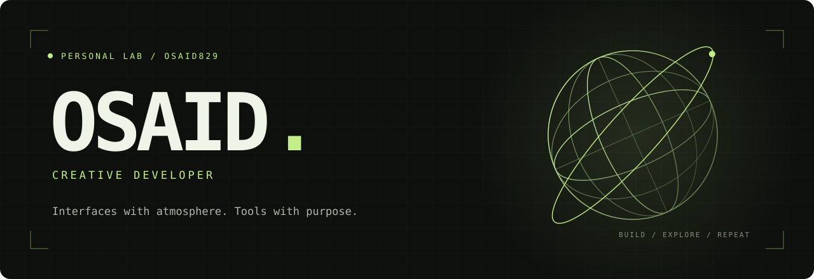

  

  <a href="https://osaid-portfolio.vercel.app">Portfolio</a> &nbsp; / &nbsp;
  <a href="https://www.linkedin.com/in/mdosaid">LinkedIn</a> &nbsp; / &nbsp;
  <a href="https://github.com/osaid829?tab=repositories">Explore my work</a>

 

### hey, i'm Osaid.

I build websites that feel like places, interfaces with a little personality, and tools that make complicated things easier to understand.

My work lives somewhere between **creative development, useful software, and fictional worlds**. Sometimes that's a cinematic 3D experience. Sometimes it's making a database execution plan readable. Either way, I like getting the details right.

`creative frontend` &nbsp; `interactive 3D` &nbsp; `developer tools`

 

### selected transmissions

| Project | What you'll find |
| :--- | :--- |
| **[KORA](https://github.com/osaid829/kora-interactive-experience)** | A fictional Himalayan sanctuary, explored through 3D, light, and scroll-driven storytelling. [Enter the experience ↗](https://3d-interactive-website-ashen.vercel.app) |
| **[Human SQL Reader](https://github.com/osaid829/human-sql-reader)** | PostgreSQL and MySQL execution plans translated into plain-English insights. Evidence first, zero runtime dependencies. |
| **[Red Rising](https://github.com/osaid829/redrisingsaga-fansite)** | An unofficial fan experience built around lore, cinematic visuals, and a universe I enjoy. [Explore ↗](https://redrisingsaga-fansite.vercel.app) |
| **[Personal portfolio](https://github.com/osaid829/osaid-portfolio)** | Interactive 3D studies, selected work, and a playable browser arcade. Yes, the games are part of the portfolio. |

 

### in the toolkit

**Interfaces** &nbsp; JavaScript · TypeScript · React · Next.js · HTML · CSS · Tailwind

**Depth & motion** &nbsp; Three.js · React Three Fiber · GSAP · Lenis

**Under the hood** &nbsp; Node.js · Python · SQL

 

### things i keep coming back to

- Turning a screen into an experience, with typography, motion, and a sense of place.
- Making technical information useful to the person reading it.
- Building around worlds and ideas I actually care about.

 

---

OSAID / PERSONAL LAB &nbsp; · &nbsp; a little atmosphere. a lot of iteration.

